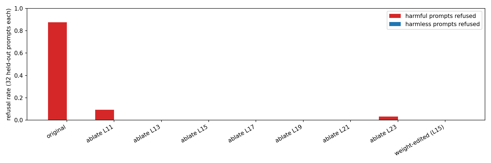
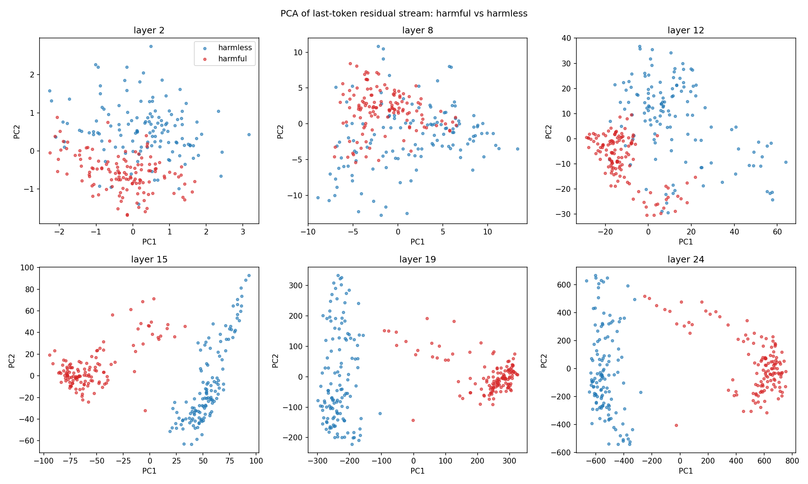
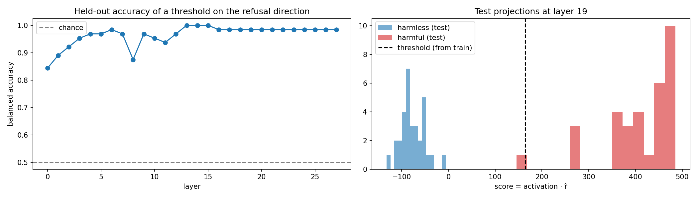

# Finding and Removing the Refusal Direction in Qwen3-1.7B

A hands-on mechanistic interpretability study: locating the direction in a language model's activation space that encodes **"I should refuse this"**, verifying that it is *causal*, and removing it from the model's weights with a single linear-algebra operation, without any training.

> **TL;DR:** In Qwen3-1.7B, refusal of harmful requests is mediated by a single direction in the residual stream that emerges around layer 15. Projecting this direction out of the 57 matrices that write to the residual stream drops the refusal rate on held-out harmful prompts from **88% → 0%**, while harmless prompts remain at **0%** refusal and answers stay fluent.

> **Note:** This is an interpretability and AI-safety research project. No modified model weights are distributed, and no harmful completions are included. See [Responsible use](#responsible-use).



---

## Results at a glance

| Model | Harmful prompts refused | Harmless prompts refused |
|---|---|---|
| Original Qwen3-1.7B | **88%** | 0% |
| Direction from layer 11 ablated (hooks) | 9% | 0% |
| Direction from layers 13–21 ablated (hooks) | **0%** | 0% |
| Direction from layer 23 ablated (hooks) | 3% | 0% |
| **Weights edited (direction from layer 15)** | **0%** | **0%** |

*Evaluated on 32 held-out harmful and 32 held-out harmless prompts that were never used to compute the direction.*

---

## Why this matters

Safety behaviours such as refusing harmful requests are taught to models through expensive fine-tuning. This project shows, on a small model, how **shallow** that behaviour can be at the representation level: it is concentrated in one direction of a 2048-dimensional space, and it can be removed from openly released weights with a few lines of code and no gradient updates.

This is a central argument in the open-weights safety debate. It is also a clean, small-scale demonstration of a key idea in interpretability: **finding a feature is not enough; you have to intervene on it to show it is causal.**

---

## Why Qwen3-1.7B?

- **Small enough for a free GPU.** ~3.4 GB in float16 fits comfortably on a free Google Colab T4 (15 GB), leaving room for activations and experiments.
- **Open license.** Released under Apache 2.0, which permits modification and research use.
- **Widely used and well supported** by Hugging Face `transformers`, so results are easy to reproduce.
- **Has real safety training.** It refuses most harmful requests out of the box (88% in our baseline), so there is a behaviour to study.

Released by Alibaba's Qwen team on 30 April 2025. Architecture: 28 decoder layers, residual stream width (`d_model`) 2048, MLP width 6144, grouped-query attention (16 query / 8 key-value heads), tied input/output embeddings, ~1.7B parameters.

---

## Background: the idea in one paragraph

In a transformer, every token carries a vector (the **residual stream**) that each layer reads from and **adds** its output to: `x ← x + F(x)`. Because the final vector is a *sum* of contributions, a concept that is represented as a **direction** `r̂` in this space can only get there through the matrices that write into the stream. If we make every writer unable to write along `r̂`, i.e. replace each writer `W` with `W − r̂ r̂ᵀ W`, the concept can no longer appear. Arditi et al. (2024) showed that refusal in many chat models is mediated by such a single direction. This project reproduces that finding on Qwen3-1.7B from scratch and documents each step.

---

## Method

The project is split into four notebooks; each saves its outputs to Google Drive so the next one can start without recomputing.

### 1. Setup and anatomy (`01_setup_and_anatomy.ipynb`)
- Load the model and inspect its architecture.
- Identify which modules **write** to the residual stream:
  `embed_tokens` (1) + attention `o_proj` (28) + MLP `down_proj` (28) = **57 writer matrices**.
  Everything else (`q/k/v_proj`, `gate/up_proj`, norms, `lm_head`) only reads.
- Inspect the chat template the model actually sees, including how `enable_thinking=False` pre-fills an empty `<think></think>` block.

### 2. Collecting activations (`02_collect_activations.ipynb`)
- **Prompts:** 128 + 32 harmful prompts from AdvBench and 128 + 32 harmless instructions from Alpaca (train / held-out test), shuffled with a fixed seed.
- **Forward hooks** on all 28 decoder layers record the residual stream at the **last prompt token**, the position where the model decides the first token of its answer.
- Batched with **left padding** so the last real token is always at index `-1`; position ids are recomputed so padding doesn't shift them.
- Output: activations of shape `[128, 28, 2048]` per set.

### 3. Finding the refusal direction (`03_find_refusal_direction.ipynb`)
- For each layer, the candidate direction is the **difference of means**:
  `r_layer = mean(harmful) − mean(harmless)`, normalized to unit length.
- Analysed with relative norm per layer, cosine similarity between layers, PCA, and a held-out projection test.

### 4. Ablation (`04_ablation.ipynb`)
- **Baseline:** refusal rate of the original model on held-out prompts, using a keyword-based refusal detector on 48-token completions.
- **Hook ablation:** remove the component along `r̂` from the output of all 57 writers at inference time (`out ← out − (out·r̂) r̂`), for candidate directions from layers 11–23.
- **Side effects:** compare harmless answers before and after ablation.
- **Weight editing:** bake the best direction into the weights:
  - `nn.Linear` writers (`[2048, in]`): `W ← W − r̂ (r̂ᵀ W)`
  - embedding (`[vocab, 2048]`): `E ← E − (E r̂) r̂ᵀ`
- **Verification:** weight-edited model vs. hook-ablated model.

---

## Findings

### Refusal emerges around layer 15 and stabilizes after layer 19



- The relative difference between harmful and harmless activations is small in layers 0–10, **jumps between layers 14 and 15**, and peaks around layers 19–20.
- Cosine similarity between per-layer directions shows a thin diagonal band in early layers (the direction keeps changing) and a **stable block from layer ~19 onward** (the direction is carried forward almost unchanged). This supports the single-direction hypothesis in middle-to-late layers.
- PCA, which is unsupervised, separates harmful from harmless prompts **along the first principal component** from layer 19 onward: the harmful/harmless distinction becomes the largest source of variation in the representation.
- Harmful prompts collapse into a **tight cluster** while harmless prompts stay spread out, consistent with diverse requests converging to a shared "refusal mode".

### Separating is not the same as causing



A threshold on the projection onto each layer's direction classifies **held-out** prompts with ~98–100% balanced accuracy in middle layers, so the direction generalizes. But even **layer 0** (raw token embeddings, no processing at all) reaches **84%**: early directions mostly detect surface features (templates like "Write a script…", words like "hack"). Projection is **correlational**; only an intervention can show causality.

### Ablation shows the direction is causal

- Removing directions from layers 13–21 eliminates refusals entirely (88% → 0%).
- Harmless answers remain fluent and correct. Mean text similarity to the original answers is ~0.6, but this reflects the **butterfly effect** of greedy decoding (one changed early token → a different but equally valid continuation), not degradation. Manual inspection confirmed the answers stay on-topic.
- On harmful prompts, the ablated model produces fluent, on-task openings rather than gibberish or soft refusals: the 0% is genuine compliance.
- **Side observation:** some ablated harmless answers start with "Sure!" where the original did not, suggesting the direction encodes a broader *cautiousness*, not only refusal.
- Layer 15 was chosen for the final model: 0% refusal and the highest similarity on harmless answers.

### Engineering details that mattered
- **Tied embeddings:** Qwen3-1.7B shares one matrix between `embed_tokens` and `lm_head`. Editing the embedding without untying first would silently change the output layer too.
- **Weight orientation:** `nn.Linear` stores weights as `[out, in]`, embeddings as `[vocab, d_model]`, so the same projection is applied on different sides.
- **Precision:** edits are computed in float32 and cast back to float16. The weight-edited model matches the hook-ablated model on **31/32** harmless answers (similarity 0.99); the single difference is due to float16 rounding.

---

## Limitations

- **Small evaluation set:** 32 + 32 held-out prompts; one prompt = ~3 percentage points.
- **Keyword-based refusal detection:** misses soft refusals (e.g. lecturing instead of complying) and can produce false positives. The true baseline refusal rate is likely slightly *higher* than 88%.
- **Dataset style confound:** AdvBench prompts share templates that Alpaca prompts do not, so the difference-of-means direction also carries surface features.
- **Coarse side-effect metric:** text similarity measures change, not quality; no capability benchmark was run.
- **Single model, single seed.**

---

## Responsible use

- **No modified weights are distributed** in this repository. The value of the project is the method and the analysis; a 1.7B abliterated model adds nothing new to the ecosystem.
- The evaluation only measures **whether** the model refuses. Harmful completions were capped at 48 tokens, not inspected beyond their first few words, and are **not included** in any notebook output.
- Harmful prompts come from AdvBench, a standard public safety benchmark.
- This work is intended for education and safety research: understanding how fragile safety training can be is a prerequisite for building more robust safeguards.

---

## Reproducing

**Requirements:** a Google account and a free Colab T4 GPU (stage 3 runs on CPU).

```text
torch
transformers
datasets
pandas
scikit-learn
matplotlib
```

**Run order:**
1. `01_setup_and_anatomy.ipynb`: load the model and explore the architecture.
2. `02_collect_activations.ipynb`: collect train and test activations (saved to `MyDrive/abliteration/`).
3. `03_find_refusal_direction.ipynb`: compute and analyse directions (CPU runtime is enough).
4. `04_ablation.ipynb`: baseline, hook ablation, weight editing, verification.

Total runtime: well under an hour of GPU time. Generation is greedy (`do_sample=False`) and data shuffling uses `seed=42`, so results are deterministic up to hardware/library differences.

---

## Repository structure

```
qwen3-refusal-direction/
├── README.md
├── 01_setup_and_anatomy.ipynb
├── 02_collect_activations.ipynb
├── 03_find_refusal_direction.ipynb
├── 04_ablation.ipynb
├── figures/
│   ├── refusal_rates.png
│   ├── pca_layers.png
│   ├── projection_test.png
│   ├── relative_difference.png
│   └── cosine_similarity.png
└── notes/                     # step-by-step learning notes for each stage
    ├── 01-transformer-basics.md
    ├── 02-residual-writers-and-chat-template.md
    ├── 03-collecting-activations.md
    ├── 04-finding-the-refusal-direction.md
    └── 05-ablation.md
```

---

## Future work

- **Steering:** *add* `α·r̂` to harmless prompts and test whether the model starts refusing them, proving causality from the other side.
- **Better side-effect metrics:** KL divergence between next-token distributions; a small capability benchmark (e.g. a subset of MMLU).
- **Control experiment:** ablate an early-layer direction (e.g. layer 2), where the direction should be mostly surface features.
- **Scaling:** repeat on Qwen3-4B and compare where refusal emerges and how stable the direction is.
- **More robust evaluation:** larger held-out sets and an LLM-based refusal judge instead of keywords.

---

## References

- Arditi, A., Obeso, O., Syed, A., Paleka, D., Panickssery, N., Gurnee, W., & Nanda, N. (2024). *Refusal in Language Models Is Mediated by a Single Direction.* NeurIPS 2024. [arXiv:2406.11717](https://arxiv.org/abs/2406.11717)
- Zou, A., Wang, Z., Kolter, J. Z., & Fredrikson, M. (2023). *Universal and Transferable Adversarial Attacks on Aligned Language Models* (source of AdvBench). [arXiv:2307.15043](https://arxiv.org/abs/2307.15043) · [llm-attacks](https://github.com/llm-attacks/llm-attacks)
- Taori, R. et al. (2023). *Stanford Alpaca: An Instruction-following LLaMA Model.* [tatsu-lab/stanford_alpaca](https://github.com/tatsu-lab/stanford_alpaca)
- Qwen Team. *Qwen3-1.7B.* [huggingface.co/Qwen/Qwen3-1.7B](https://huggingface.co/Qwen/Qwen3-1.7B)

---

## License

This project is released under the Apache License 2.0, the same license as the base model Qwen3-1.7B.
